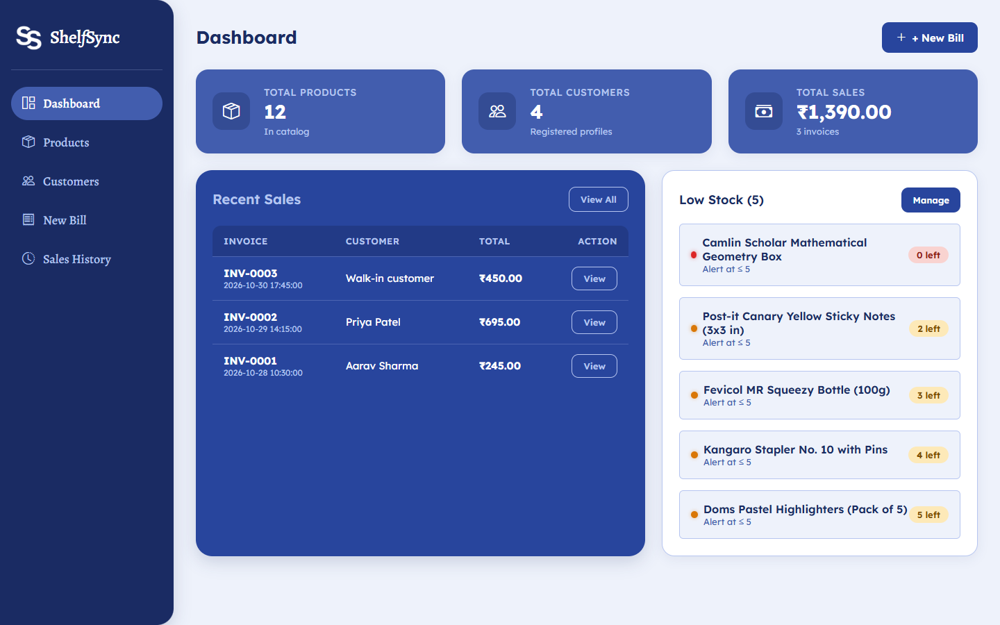
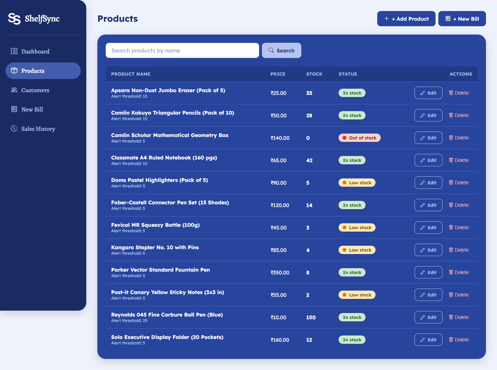
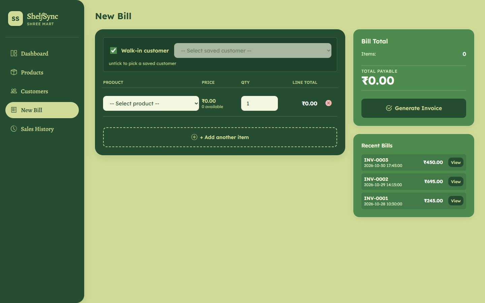
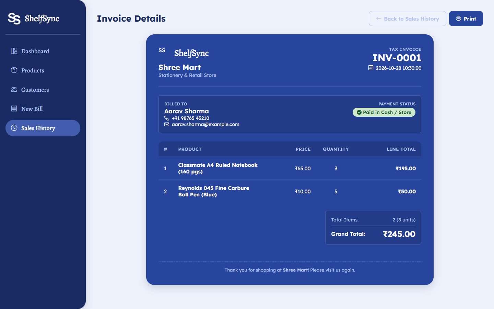
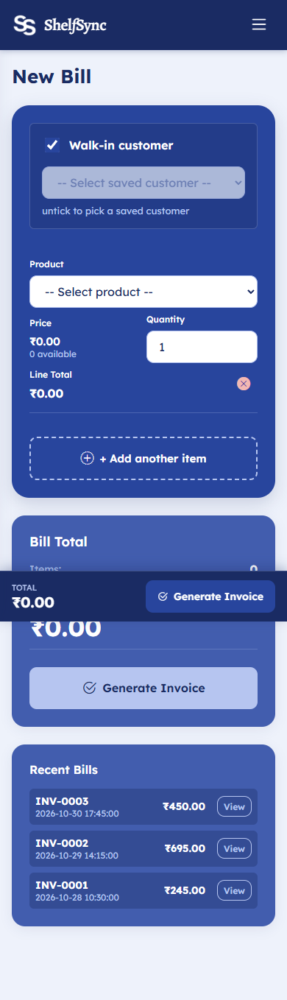

# ShelfSync

> A clean, responsive Mini Inventory & Billing Management System for "Shree Mart" retail shop.
---

## Screenshots

### Desktop View (1440px)

#### Dashboard


#### Products Catalog & Search


#### New Bill & Real-time Calculation


#### Invoice Details & Print View


---

### Mobile View (390px)

#### Responsive Mobile Billing with Sticky Summary Bar
<p align="center">
  
</p>

---

## Features

- **Dashboard Overview**: Instant summary of Total Products, Total Registered Customers, and Total Sales with invoice counts. Quick view of recent 5 sales and live alerts for low-stock and out-of-stock stationery items.
- **Product Management**: Search products by name, add new stationery items, edit pricing or stock, and configure customizable low-stock alert thresholds.
- **Safe Inventory Guardrails**: Products linked to historical invoices cannot be deleted (prevents broken foreign key relations). Users are cleanly instructed to set stock to 0 instead.
- **Customer Directory**: Track registered customer profiles (name, phone, email) with server-side email validation.
- **Fast Interactive Billing**: Real-time line-total and grand-total calculation in JavaScript. Supports both registered and walk-in customers.
- **Robust Transactional Billing**: Atomically validates stock, merges duplicate product rows, deducts inventory, and records invoices inside a single SQLite `BEGIN IMMEDIATE` transaction.
- **Tamper-Proof Pricing**: The server is the sole source of truth; any browser-supplied prices or totals are discarded. Prices and product names are copied onto invoice line items as historical snapshots so future price modifications never alter past receipts.
- **Print-Ready Invoices**: Formatted for standard paper printing (hiding sidebars and navigation buttons automatically).
- **Sales History**: Chronological log of past sales with one-click access to detailed invoices.
- **Strict Custom Design System**: Palette centered around dark spruce (`#254D32`), light sage (`#D0DB97`), and forest green (`#4D8B4F`), paired with Lexend and Alegreya typography and rounded geometric cards.
- **Fully Responsive**: Fluid layout adapted seamlessly for desktop (1440px), tablet (768px), and mobile (390px).

---

## Tech Stack

- **Backend**: Python 3, Flask 3.x
- **Database**: SQLite3 (using Python's standard library `sqlite3` with plain parameterized SQL — no ORM or external query builders)
- **Templating**: Jinja2 with HTML autoescaping
- **Frontend Styling**: Bootstrap 5 (grid and utilities only via CDN), Bootstrap Icons via CDN, and pure custom CSS in `static/style.css`
- **Interactivity**: Plain JavaScript (`static/bill.js`, no frontend frameworks)
- **Testing**: `pytest`

---

## Setup Steps

### 1. Clone the Repository
```bash
git clone https://github.com/Nid-build01it/ShelfSync.git
cd ShelfSync
```

### 2. Create and Activate a Virtual Environment
```bash
# On Linux / macOS
python3 -m venv venv
source venv/bin/activate

# On Windows (PowerShell)
python -m venv venv
.\venv\Scripts\Activate.ps1
```

### 3. Install Dependencies
```bash
pip install -r requirements.txt
```

### 4. Create Database and Load Sample Data
Initialize SQLite schema and load sample stationery data for Shree Mart in one command:
```bash
python seed.py
```

### 5. Run the Application
```bash
python app.py
```
Open your browser and navigate to: **`http://127.0.0.1:5000`**

### 6. Run Automated Tests
```bash
pytest
```

---

## How Billing and Stock Updates Work

1. **Client Calculation vs. Server Authority**:
   When preparing a bill in the browser, JavaScript automatically calculates line totals and grand totals for immediate visual feedback. However, upon submitting the form, the server **completely ignores any prices, totals, or stock amounts sent by the browser**. The server fetches fresh prices and stock numbers directly from the SQLite database.

2. **Merging Duplicate Items**:
   If a user adds the same product on multiple rows, `billing.py` combines the quantities together *before* checking stock. For example, if row 1 requests 2 notebooks and row 2 requests 3 notebooks (total 5), and only 4 are in stock, the bill is cleanly rejected with `"Only 4 left of Classmate A4 Ruled Notebook"`.

3. **All-or-Nothing Transactions (`BEGIN IMMEDIATE`)**:
   Billing operations are executed within an explicit SQLite `BEGIN IMMEDIATE` transaction. This immediately acquires a write lock so concurrent sales cannot oversell the same item. If any validation fails (e.g., negative quantity, non-existent customer, or insufficient stock for any single item), the entire transaction rolls back via `ROLLBACK`. Nothing is saved, no stock is altered, and the user receives a helpful error message with their input preserved.

4. **Historical Price Snapshotting**:
   When an invoice successfully commits:
   - The product's current name and price in paise are copied directly into the `invoice_items` record.
   - If the store manager later edits the product price in the catalog (e.g., from ₹65.00 to ₹75.00), old invoice records and sales history retain the exact price charged at the moment of sale.
   - Stock quantities are deducted atomically with database-level checks (`CHECK(stock_quantity >= 0)`).

5. **Exact Money Handling (No Floats)**:
   All monetary amounts are stored as integer **paise** (1 Rupee = 100 paise) throughout the database and backend logic. This prevents floating-point rounding errors common in financial arithmetic. Formatting into the Indian numbering system (`₹1,51,060.00`) is handled purely at the display layer via a custom Jinja filter.

---

## Database Schema (4 Tables)

ShelfSync operates on four relational tables defined in `schema.sql` with foreign keys enabled:

1. **`products`**:
   - `id`: Integer primary key (autoincrement).
   - `name`: Text (up to 100 characters, required).
   - `price_paise`: Integer (>= 0, required).
   - `stock_quantity`: Integer (>= 0, required).
   - `low_stock_threshold`: Integer (>= 0, default 5).
   - `created_at`: Timestamp.

2. **`customers`**:
   - `id`: Integer primary key (autoincrement).
   - `name`: Text (required).
   - `phone`: Text (optional).
   - `email`: Text (optional).
   - `created_at`: Timestamp.

3. **`invoices`**:
   - `id`: Integer primary key (autoincrement).
   - `customer_id`: Integer foreign key referencing `customers(id)` (`ON DELETE SET NULL`, NULL for walk-in sales).
   - `created_at`: Timestamp.
   - `total_paise`: Integer (>= 0, required).

4. **`invoice_items`**:
   - `id`: Integer primary key (autoincrement).
   - `invoice_id`: Integer foreign key referencing `invoices(id)` (`ON DELETE CASCADE`).
   - `product_id`: Integer foreign key referencing `products(id)` (`ON DELETE RESTRICT`).
   - `product_name`: Text (snapshot of product name at time of sale).
   - `quantity`: Integer (>= 1, required).
   - `unit_price_paise`: Integer (snapshot of unit price at time of sale).
   - `line_total_paise`: Integer (quantity × unit price in paise).

---

## Assumptions

1. **Currency**: All pricing is in Indian Rupees (INR ₹), stored as integer paise to guarantee arithmetic precision.
2. **Walk-in Customers**: When "Walk-in customer" is selected, the invoice's `customer_id` is stored as `NULL`, and the invoice displays "Walk-in customer".
3. **Out-of-Stock Prevention**: Products with 0 stock cannot be selected on new bills.
4. **Product Deletion Guard**: If a product has ever been purchased on an invoice, deleting it is blocked with a friendly explanation (`"Cannot delete, used in N invoices. Set its stock to 0 instead."`).
5. **No Extra Libraries**: CSRF tokens are generated using Python's built-in `secrets` module and verified against the user session on all POST submissions.
6. **No Tax or Discounts**: In accordance with specification constraints, no taxes, discounts, or coupon systems are included.

---

## Limitations and Future Improvements

- **User Authentication**: Currently designed as an internal shop counter system; future iterations can add role-based logins (Admin vs. Cashier).
- **PostgreSQL Migration**: While SQLite is ideal for a single-store desktop or light web setup, moving to PostgreSQL would support high concurrency across multiple registers.
- **Direct PDF Export**: While browser print (`Ctrl+P`) renders a clean print invoice, direct PDF downloads (e.g., via WeasyPrint) could be added.
- **Tax and Discounts**: Adding GST percentages (CGST / SGST) and promotional line-item discounts.
- **Returns and Credit Notes**: Handling partial refunds, item returns, and inventory restoration.

---

## AI Usage Disclosure

Planning was done with Claude (Anthropic) and implementation with Google Antigravity. I reviewed and tested the code and I can explain how it works.
